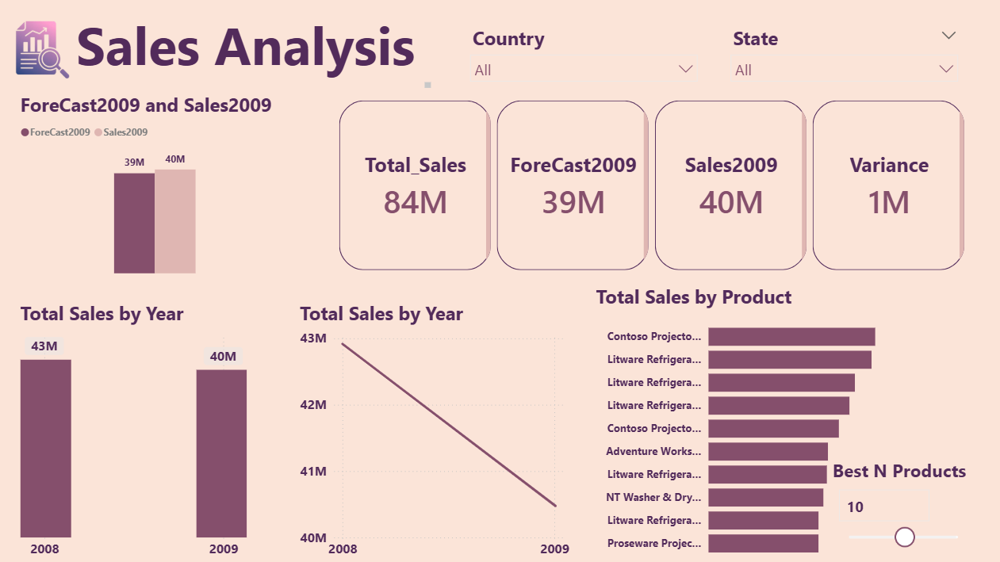
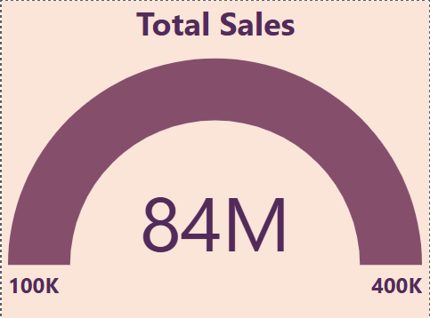
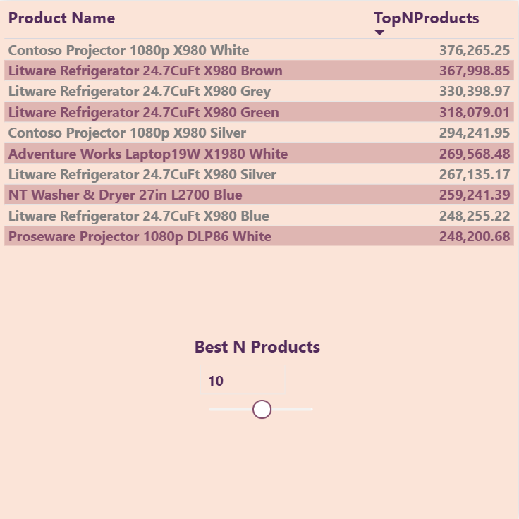

# Sales Forecast & Trend Dashboard | Power BI

A Power BI practice project tracking historical sales trends, best-selling products, and year-over-year performance, with a forecast-vs-actual comparison for 2009.

## Key Techniques
- DAX time-intelligence measures (year-over-year sales trend, 2008 vs 2009)
- Forecast vs. actual comparison with variance analysis
- Dynamic Top N products using a "Best N Products" parameter slider
- Tooltip pages (gauge and Top N table on hover)
- Gauge visual for total sales
- Country and State slicers for interactive filtering

## Key Measures
`Total_Sales` · `ForeCast2009` · `Sales2009` · `Variance` · `TopNProducts`

## Dashboard Preview

### 1. Sales Analysis (Main Page)
KPI cards, forecast vs. actual, yearly sales trend, and best-selling products.

### 2. Total Sales Gauge (Tooltip Page)
Gauge visual summarizing total sales, shown on hover.

### 3. Top N Products (Tooltip Page)
Ranked product table controlled by the Best N Products slider.

## Tools
Power BI Desktop, DAX, Power Query

## Files
- `Sales_Forecast_Trend_Dashboard.pbix` – the Power BI report
- `screenshots/` – preview of each report page

## How to Open
Download the `.pbix` file and open it with Power BI Desktop.
